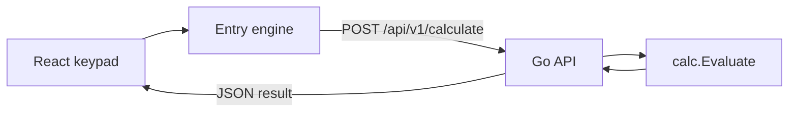

# Calculator

A small calculator with a React keypad and a Go service. The keypad edits the number on screen. Every arithmetic result comes from `POST /api/v1/calculate`.



## Prerequisites

- Go 1.22 or newer
- Node.js 18.18 or newer and npm
- Optional: Docker, to run the UI and API in one container

## Run it locally

Use two terminals.

```bash
cd backend
go run ./cmd/server
```

The API listens on [http://localhost:8080](http://localhost:8080). `GET /health` returns `{"status":"ok"}`.

```bash
cd frontend
npm install
npm run dev
```

Open [http://localhost:5173](http://localhost:5173). Vite proxies `/api` and `/health` to port 8080, so the browser talks to one origin during development.

If the UI is hosted somewhere else and should call the API directly, set `VITE_API_BASE` (for example `http://localhost:8080`) when starting Vite. The server allows that origin when `ALLOWED_ORIGIN` matches it. The default is `*`.

### Environment

| Variable | Default | Purpose |
| --- | --- | --- |
| `PORT` | `8080` | API port |
| `ALLOWED_ORIGIN` | `*` | Value of `Access-Control-Allow-Origin` |
| `STATIC_DIR` | empty | Directory of the built UI. When set, the API also serves that site |
| `VITE_API_BASE` | empty | Frontend override for the API origin |

## Tests and coverage

```bash
cd backend
go test ./...
go test ./... -coverprofile=coverage.out
go tool cover -func=coverage.out
go tool cover -html=coverage.out -o coverage.html

cd frontend
npm test
npm run coverage
```

The HTML coverage report for the UI is written to `frontend/coverage/index.html`. A `Makefile` wraps the same commands for environments that have `make`: `make test` and `make coverage`.

## API

`POST /api/v1/calculate`

```json
{ "operation": "add", "a": 2, "b": 3 }
```

```json
{ "result": 5, "operation": "add", "expression": "2 + 3" }
```

`a` is always required. `b` is required for `add`, `subtract`, `multiply`, `divide`, and `power`. `sqrt` ignores `b`. `percent` uses `b` when it is present and otherwise divides `a` by 100.

| Operation | Meaning | Example |
| --- | --- | --- |
| `add` | a + b | 2 and 3 → 5 |
| `subtract` | a − b | 10 and 4 → 6 |
| `multiply` | a × b | 6 and 7 → 42 |
| `divide` | a ÷ b | 7 and 2 → 3.5 |
| `power` | a^b | 2 and 10 → 1024 |
| `sqrt` | √a | 9 → 3 |
| `percent` | b% of a, or a/100 when b is omitted | 200 and 15 → 30; 50 → 0.5 |

Numbers are IEEE-754 binary64, the same domain Go's `float64` and JavaScript's `number` share. Integers above 2^53 are not all representable.

### curl

PowerShell aliases `curl` to a different command. Use `curl.exe` there.

```bash
curl -s http://localhost:8080/health

curl -s http://localhost:8080/api/v1/calculate \
  -H "Content-Type: application/json" \
  -d "{\"operation\":\"divide\",\"a\":7,\"b\":2}"

curl -s http://localhost:8080/api/v1/calculate \
  -H "Content-Type: application/json" \
  -d "{\"operation\":\"sqrt\",\"a\":9}"

curl -s http://localhost:8080/api/v1/calculate \
  -H "Content-Type: application/json" \
  -d "{\"operation\":\"percent\",\"a\":200,\"b\":10}"
```

### Errors

Failures use 400 and a JSON message. The body is at most 1 MiB.

| Status | When |
| --- | --- |
| 400 | Malformed JSON, missing operands, unknown operation, division by zero, square root of a negative number, or a non-finite result |
| 405 | The path exists but the method is wrong |
| 413 | The body is larger than 1 MiB |
| 415 | `Content-Type` is present and is not JSON |

```bash
curl -s -i http://localhost:8080/api/v1/calculate \
  -H "Content-Type: application/json" \
  -d "{\"operation\":\"divide\",\"a\":1,\"b\":0}"
```

```json
{ "error": "division by zero" }
```

`0^0` returns 1, matching Go's `math.Pow`. A negative base raised to a fractional power, and overflow such as `1e308 * 10`, are rejected because the result is not finite.

## Docker

From the repository root, after `frontend/package-lock.json` exists (`npm install` creates it):

```bash
docker compose up --build
```

Open [http://localhost:8080](http://localhost:8080). The image builds the UI, builds a static Go binary, and serves both. `STATIC_DIR` points at the built files, and client requests stay on the same origin.

## How the keypad uses the API

Typing, backspace, the decimal point, and the sign toggle stay in the browser. They change the entry that will be sent; they do not produce a result. The sign toggle negates that entry locally so the following request can send the negated number.

Pressing `=`, an operator, `√`, or `%` asks the service to compute.

- Binary operations run left to right, not by algebraic precedence. `2 + 3 × 4` commits `2 + 3` first and then multiplies the result by 4, so the result is 20.
- Pressing a second operator before a new number replaces the armed operator. `8 + −` waits to subtract.
- Pressing `=` before a second number repeats the number on screen. `2 + =` sends `2 + 2`.
- `√` replaces the entry on screen. If a second operand has already been typed, only that operand is replaced: `9 + 16 √ =` sends `√16`, then `9 + 4`. If an operator is armed but no second operand has been typed, `√` cancels it.
- `%` after a second operand asks for "b percent of a" and keeps the pending operation. `200 + 10 % =` sends `percent(200, 10)` → 20, then `add(200, 20)` → 220. `%` with no second operand sends `percent(a)` → `a / 100`.
- The value stored for the next request is the raw JSON number, not the rounded string in the readout. `2 ÷ 3 × 3` stays exact.
- The readout keeps 10 decimal places and switches to scientific notation outside `1e-9` … `1e12`. The tape shows the expression returned by the server, newest first, up to eight lines.
- A failed request clears the pending operation and shows the API message. The next digit starts a new entry. `AC` clears the entry and leaves the tape.

The keypad is a 4-column grid that wraps under the tape on narrow screens. Buttons are at least 44px tall. Digits, `+ − * / ^`, Enter, Esc, Backspace, and `%` work from the keyboard. The header reports whether `GET /health` succeeded.

## Design decisions

The calculation rules live in `backend/internal/calc` and do not know about HTTP. Handlers in `backend/internal/httpapi` decode one JSON object, reject unknown fields, and map domain errors to status codes. The standard library is enough: `net/http`, `encoding/json`, and `math`. One endpoint keeps validation in one place and makes a new operation a name plus a branch, rather than a new route.

The UI's rules live in `frontend/src/engine.ts`, which is a pure function from state and an action to the next state and, sometimes, a request. `Calculator.tsx` performs that request. Tests can run the keypad rules without rendering, and the component tests supply a fake service so they do not need a live server.

The API is stateless. The tape exists only in the page. There is no account and no stored history, which is why `ALLOWED_ORIGIN` defaults to `*` for this exercise. A deployed service that should only be called by one site can set that variable to the site's origin.

`cmd/server` is the process entrypoint. It logs each request and shuts down on interrupt. Tests construct `httpapi.NewHandler` directly and do not bind a port.

## Layout

```
backend/
  cmd/server/main.go          process entrypoint
  internal/calc/              operations and their tests
  internal/httpapi/           HTTP adapter and its tests
frontend/
  src/engine.ts               keypad state machine
  src/api.ts                  fetch client
  src/components/             readout, keys, and tape
Dockerfile                    UI and API in one image
PROMPTS.md                    prompts used while building this repo
```

## Assumptions

- A basic calculator, not an expression parser. There are no parentheses and no operator precedence.
- The decimal separator is `.`.
- Percentage on a finished second operand means "b percent of a", which is what makes `200 + 10%` equal 220. It is not a combined tax button by itself.
- Square root is defined for zero and positive numbers only.
- Results that are infinity or `NaN` are errors, not values to display.
